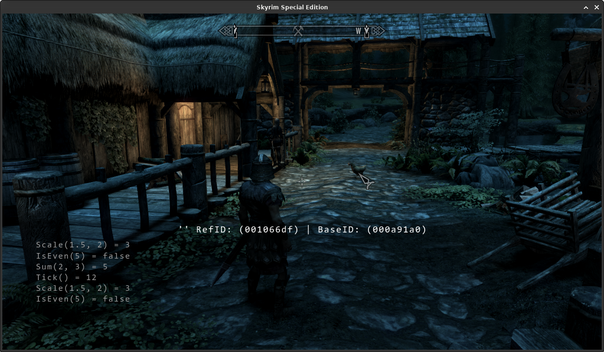

### Running Zig plugin + Papyrus script

#### Requires

- Creation Kit (Papyrus Compiler)

#### Preview



**Log** (w/ MO2)

```console
SKYRIM_PATH/overwrite/SKSE/Plugins/skse-plugin-zig-papyrus.log"
2026-11-21 11:17:48 Register: accepted
2026-11-21 11:18:34 registered ZigExampleCaller.Sum
2026-11-21 11:18:34 registered ZigExampleCaller.Tick
2026-11-21 11:18:34 registered ZigExampleCaller.Scale
2026-11-21 11:18:34 registered ZigExampleCaller.IsEven
2026-11-21 11:19:26 Sum(2, 3) = 5
2026-11-21 11:19:26 Tick() = 1
2026-11-21 11:19:26 Scale(1.5, 2) = 3
2026-11-21 11:19:26 IsEven(5) = false
```